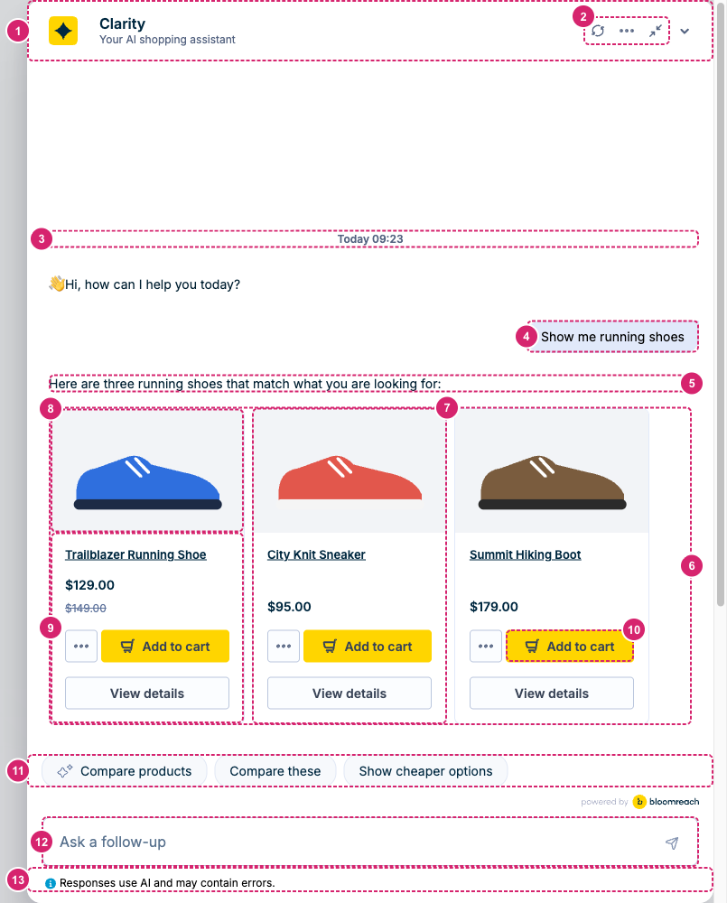
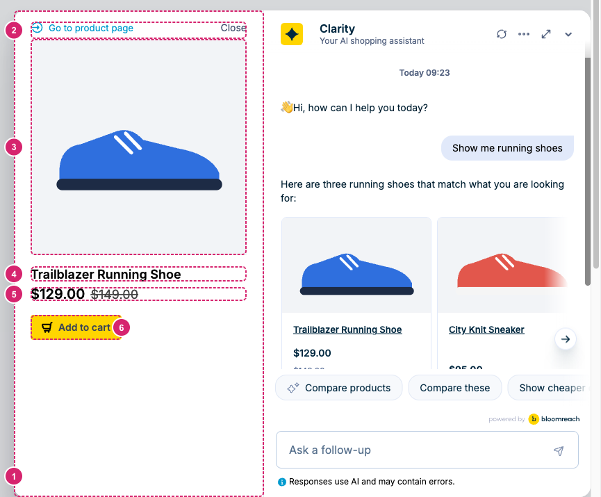
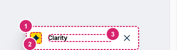
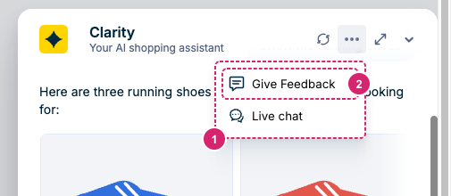

[← Back to Chapter 1 — Triggers](01-triggers.md)

# 2. Style the widget

The widget renders into your page's DOM, so your own stylesheet can restyle it. This chapter shows which class
belongs to which part of the widget and how to write overrides that win over the widget's own styles. It covers
the default widget, also when it runs as the desktop AI Mode side panel; the mobile AI Mode
(`widgetTemplate: 'ai_mode'`) has its own markup. The full class tree and every CSS variable are in
[`styles.md`](../reference/styles.md).

> **A rule that only names a widget class loses to the widget's own rule.** The widget adds its styles after your
> stylesheets, so put a selector in front of the class, see [2.3](#23-write-overrides-that-win).

---

## 2.1 Start with the configuration

Colors, the font, the position and the stacking order are configuration, not CSS. They are set in the weblayer by
your Bloomreach contact, or in [`window.CLARITY_CONFIG.ui`](../reference/widget-config.md#colors) on a standalone
page, and reach the widget as the `--clarity-widget-*` CSS variables, set inline on `#cocoaas_chat_wrapper`. Prefer
the configuration: overriding a variable in CSS needs `!important` on `#cocoaas_chat_wrapper`, and some parts take
the configured value directly, for example the badge's position and the menus' font.

| You want to change | Setting |
|---|---|
| Background, message bubbles, badge, error message colors | [`ui` colors](../reference/widget-config.md#colors) |
| Font family, `z-index`, position on the page, width | [`ui` layout and positioning](../reference/widget-config.md#layout--positioning) |
| Product image aspect ratio and fit | [`productImageRatio`, `productImageContained`](../reference/widget-config.md#product-list-display) |

Use CSS for everything else, and [component overrides](03-customize-components.md) when you need different markup
rather than a different look.

---

## 2.2 Which class is which

Only the classes listed in [`styles.md`](../reference/styles.md) are supported; elements carry further classes,
and those can change in any release.

### The open chat



| # | Class | What it is |
|---|---|---|
| 1 | `clarity-header-content` | The header bar: avatar, name, description and the buttons |
| 2 | `clarity-header-actions` | The header buttons: reset, menu, resize |
| 3 | `clarity-message-timestamp` | The date and time above a group of messages |
| 4 | `clarity-user-text-message` | A message the shopper sent |
| 5 | `clarity-assistant-text-message` | A text answer of the assistant |
| 6 | `clarity-assistant-carousel-message--horizontal` | A product carousel (`clarity-assistant-carousel-message--vertical` for a vertical list) |
| 7 | `clarity-assistant-carousel-item-wrapper` | One product card; its inner `clarity-assistant-carousel-item` also carries `class-assistant-carousel-item-<product id>` to target one product |
| 8 | `clarity-assistant-carousel-item-image` | The card's image |
| 9 | `clarity-assistant-carousel-product` | The card's text, price and buttons |
| 10 | `clarity-assistant-carousel-product-atc` | The card's add to cart button, also `clarity-button` with `clarity-button--primary` when the card shows View details, `clarity-button--secondary` otherwise |
| 11 | `clarity-assistant-quick-reply-message` | The suggested replies above the input |
| 12 | `clarity-input` | The message input with its buttons |
| 13 | `clarity-chat-legal-notice-container` | The legal notice under the input |

The open chat sits in `clarity-resizable-chat-wrapper`, whose modifier classes, such as `clarity-mobile` and
`clarity-expanded` (large size), let you style one state.

### The mini PDP

With [`ui.enableMiniPDP`](../reference/widget-config.md#feature-flags) on, clicking a product opens the mini PDP,
next to the chat (as here) or inside it.



| # | Class | What it is |
|---|---|---|
| 1 | `clarity-mini-pdp` | The mini PDP panel, also `clarity-mini-pdp--inside` when it opens inside the chat |
| 2 | `clarity-mini-pdp-header` | The top row: back or close, go to product page |
| 3 | `clarity-mini-pdp-image-container` | The product image |
| 4 | `clarity-mini-pdp-title` | The product name |
| 5 | `clarity-mini-pdp-price-container` | The price and the original price |
| 6 | `clarity-mini-pdp-atc` | The add to cart button, also `clarity-button` and `clarity-button--primary` |

### The minimized widget



| # | Class | What it is |
|---|---|---|
| 1 | `clarity-badge` | The badge that reopens the chat |
| 2 | `clarity-badge-logo-container` | The logo in the badge |
| 3 | `clarity-badge-text-container` | The badge text |

The initial message bubble above the badge is `clarity-initial-message-container`.

### Menus



| # | Class | What it is |
|---|---|---|
| 1 | `clarity-menu-dropdown` | The header menu and the product card's menu |
| 2 | `clarity-menu-item` | One entry of the menu |

### Triggers and the side panel

The triggers (floating button, embedded questions, banners) use classes with the `cui-` prefix and the
`--cui-param-*` CSS variables: the classes are listed per template in [`styles.md`](../reference/styles.md#trigger-class-hierarchy), the variables under [Trigger variables](../reference/styles.md#trigger-variables---cui-param-).
Set the variables in your stylesheet, or ask your Bloomreach contact to set them in the weblayer. The side panel's page
layout uses ids and classes with the `cocoaas-desktop-ai-mode-` prefix, see [Chapter 5](05-side-panel.md).

---

## 2.3 Write overrides that win

The widget's and the triggers' own styles come after your stylesheets, so put a selector in front of every class
you override:

- **Inside the widget**, start with `#cocoaas_chat_wrapper`, the element the widget renders into. The prefix also
  outweighs the widget's rules for states such as hover or disabled, so restyle those too when you change a color.

  ```css
  #cocoaas_chat_wrapper .clarity-user-text-message {
    border-radius: 4px;
  }

  #cocoaas_chat_wrapper .clarity-assistant-carousel-product-atc,
  #cocoaas_chat_wrapper .clarity-mini-pdp-atc {
    border-radius: 0;
  }

  #cocoaas_chat_wrapper .clarity-expanded .clarity-assistant-text-message {
    font-size: 16px;
  }
  ```

- **Menus and the PDF viewer** (`clarity-menu-dropdown`, `clarity-pdf-backdrop`) render into `document.body`,
  outside `#cocoaas_chat_wrapper`. Use a heavier selector:

  ```css
  body .clarity-menu-dropdown.clarity-menu-dropdown {
    border-radius: 0;
  }
  ```

- **Triggers**, including their `clarity-trigger-*` root classes, are not inside `#cocoaas_chat_wrapper`. An
  embedded trigger renders into an element of your page (the search suggestions into the container your page
  passes them); start with that element's id. The floating trigger sits in `document.body`: start with its root
  classes, such as `.clarity-trigger-id-<banner_id>`, and add selectors or `!important` until your rule wins.
- **The side panel's** `cocoaas-desktop-ai-mode-*` rules use ids and classes; put `body` in front of the same selector.
- **Properties the widget sets inline**, such as the badge's `padding`, need `!important`.

If an override does not take effect, your browser's developer tools show which rule applies instead, and your
Bloomreach contact is glad to help.

The widget resets inherited properties at its root, so your page's fonts and colors are not inherited into it
(a page rule that targets elements directly, such as `p { color: … }`, still applies), and every
element in it takes its font family from the configuration: set the font there ([2.1](#21-start-with-the-configuration)),
not on a class. The menus, the PDF viewer and the triggers have no such reset and inherit from your page, except
the menus' font family (from the configuration) and their text color (set by the widget), and the font family of the embedded triggers other
than the search suggestions (from their own font variable, `--cui-param-fontFamily`, …).

---

## 2.4 Check your overrides

1. Open the chat with your stylesheet loaded and inspect the element in the browser's developer tools: your rule
   must be listed above the widget's rule for the same property, not struck through.
2. Check the states you styled: small and large size, the minimized badge, mobile width, the mini PDP.
3. Check that each class you use is listed in [`styles.md`](../reference/styles.md).

---

[← Chapter 1 — Triggers](01-triggers.md) · [Chapter 3 — Customize components →](03-customize-components.md)
